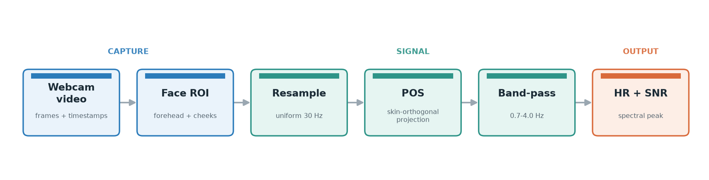
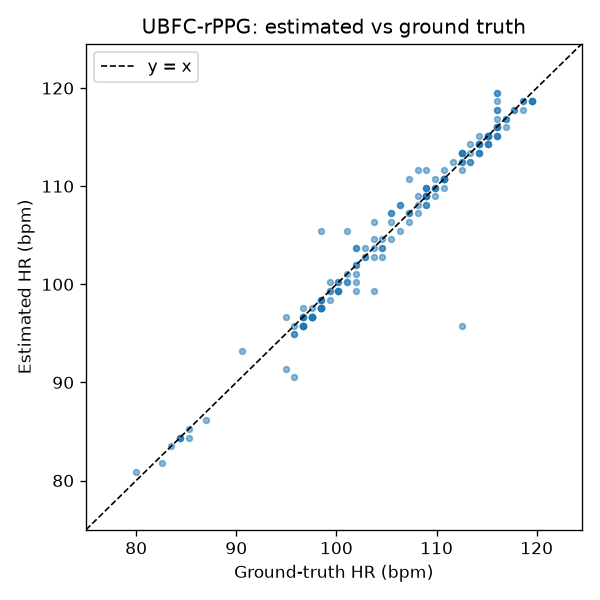
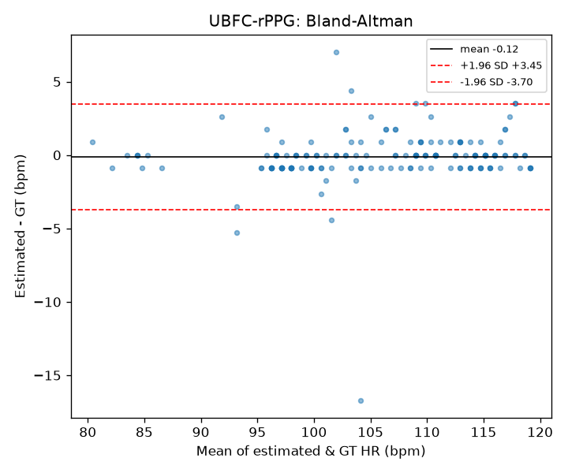

# rPPG Heart-Rate Monitor (POS)

Estimates heart rate from a standard webcam video of a face using remote
photoplethysmography (rPPG), based on the POS algorithm (Wang et al., 2017). It's a
classical signal-processing method, so nothing is trained and each result can be
traced back to a concrete step in the pipeline.



## How it works

A heartbeat changes the blood volume in the skin, which slightly changes the light
the skin reflects. The effect is invisible to the eye but recoverable from video by
averaging over enough skin pixels and filtering the result.

1. Detect the face with MediaPipe FaceLandmarker and average R/G/B over skin
   patches on the forehead and both cheeks. Eyes, mouth and hair are excluded
   because they add noise without contributing signal.
2. Webcam frame intervals aren't constant, so the per-frame colour traces are
   interpolated onto a uniform 30 Hz timeline before any filtering.
3. POS combines the R/G/B channels along a fixed projection that cancels most of
   the intensity changes caused by motion and lighting while preserving the pulse.
4. A Butterworth band-pass (0.7–4.0 Hz, or 42–240 bpm) removes everything outside
   the plausible heart-rate range.
5. Heart rate is taken as the dominant frequency in a 10-second window, stepped once
   per second. Each estimate carries an SNR value that flags unreliable readings.

## Setup

Requires Python 3.12.

```bash
python3.12 -m venv .venv
source .venv/bin/activate
pip install -r requirements.txt
bash scripts/download_model.sh      # MediaPipe FaceLandmarker model (~3.6 MB)
```

mediapipe 1.x removed the old `mp.solutions.face_mesh` API, so this uses the Tasks
API (`FaceLandmarker`). It provides the same 468-point mesh but requires the model
file that the script above downloads.

## How to run

```bash
# Live webcam demo (feed + ROI overlay + waveform + bpm + quality)
python -m app.live_demo
#   --record        save session (vid.avi + per-frame timestamps) under recordings/
#   --source clip.avi / --headless   replay a file / run without a window
#   keys: q quit, r toggle recording

# Validate on UBFC-rPPG (check the ground-truth format first, then run everything)
python -m eval.eval_ubfc --data <UBFC_root> --inspect
python -m eval.eval_ubfc --data <UBFC_root>

# Compare own recordings against a manual pulse-count log
cp eval/reference_template.csv recordings/reference.csv   # fill it in
python -m eval.eval_own
```

## Results

### UBFC-rPPG

Validated against the contact-PPG ground truth in UBFC-rPPG. The camera signal and
the reference PPG are run through the same resampling, band-pass and spectral steps,
so both sides are measured the same way.

| Subjects | Windows | MAE | RMSE | Pearson r |
|---|---|---|---|---|
| 3 | 176 | 0.91 bpm | 1.83 bpm | 0.979 |

A face was detected in every frame. The Bland–Altman bias is −0.12 bpm (no
meaningful systematic offset), and 95% of the differences fall within roughly
±3.6 bpm.




### Own webcam recordings

Three resting sessions of about a minute each, with the pulse counted by hand over
each full clip. Since the count covers the whole session, it's compared against the
session-median estimate rather than a single window.

| Session | Hand count (bpm) | rPPG (bpm) | error |
|---|---|---|---|
| A | 62 | 60.6 | 1.4 |
| B | 75 | 72.1 | 2.9 |
| C | 71 | 66.8 | 4.2 |
| MAE | | | 2.83 bpm |

The estimate reads a few bpm low in each case, which is within the accuracy of a
hand count. These are resting only; the harder conditions (movement, dim light,
elevated heart rate) haven't been measured yet.

## Limitations

Video compression is the main constraint. Lossy codecs such as H.264 and MJPG
quantise away the sub-percent colour changes the method depends on, so a heavily
compressed stream can lose the pulse entirely. The recorder writes lossless FFV1
(with an MJPG fallback) to avoid this, but webcam and streaming compression remain a
hard limit on accuracy.

Motion is the next issue: head movement introduces colour changes that POS cannot
fully remove. Lighting matters as well. Steady daylight works best, while flickering
LED lighting can alias into the heart-rate band and produce a confident but
incorrect reading, which is what the SNR indicator is meant to catch. Webcam
auto-exposure and auto white balance also work against the signal and should be
locked where the camera allows it (most built-in Mac cameras don't). Darker skin
tones reflect a weaker pulse signal, a known fairness limitation of rPPG.

The manual pulse count is only accurate to about ±3 bpm, so the UBFC numbers are the
reliable accuracy figure and the own-recording results serve as a sanity check.

## Possible next steps

Using the pulse signal as a cue for deepfake detection is an established research
direction (for example FakeCatcher, DeepRhythm, and "DeepFakes Have No Heart"). The
idea is that a real face carries a coherent pulse, while generated or manipulated
video often fails to reproduce one consistently. A natural extension here would be
to extract the pulse spectrum from real and fake clips (for example the DFDC
samples) and compare them, as a reproduction of that prior work rather than a new
method.

Smaller improvements include weighting the ROIs by signal quality, running the full
UBFC set rather than a few subjects, and more motion-tolerant tracking.

## References

- W. Wang, A. C. den Brinker, S. Stuijk, G. de Haan, *Algorithmic Principles of
  Remote PPG*, IEEE TBME 64(7):1479–1491, 2017. (POS algorithm, implemented here.)
- UBFC-rPPG dataset (Bobbia et al.); MediaPipe FaceLandmarker (google-ai-edge).
- rPPG for deepfake detection: Ciftci et al., *FakeCatcher* (IEEE TPAMI, 2020);
  Qi et al., *DeepRhythm* (ACM MM, 2020); *DeepFakes Have No Heart* (2022).
